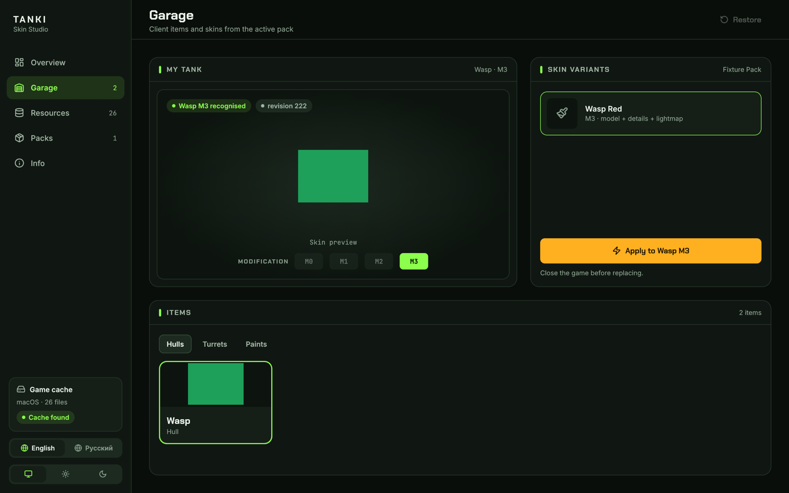
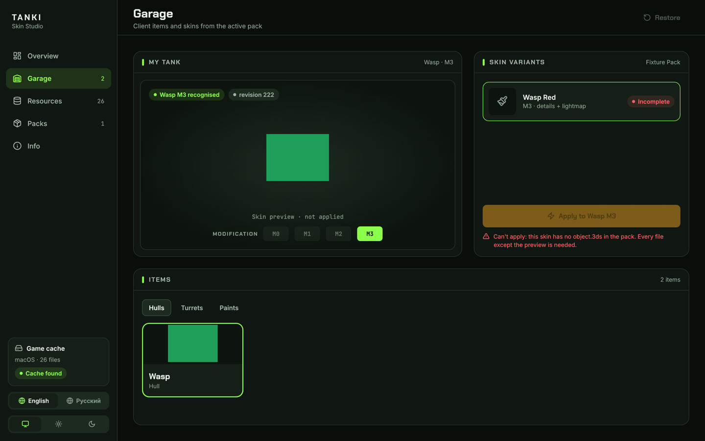
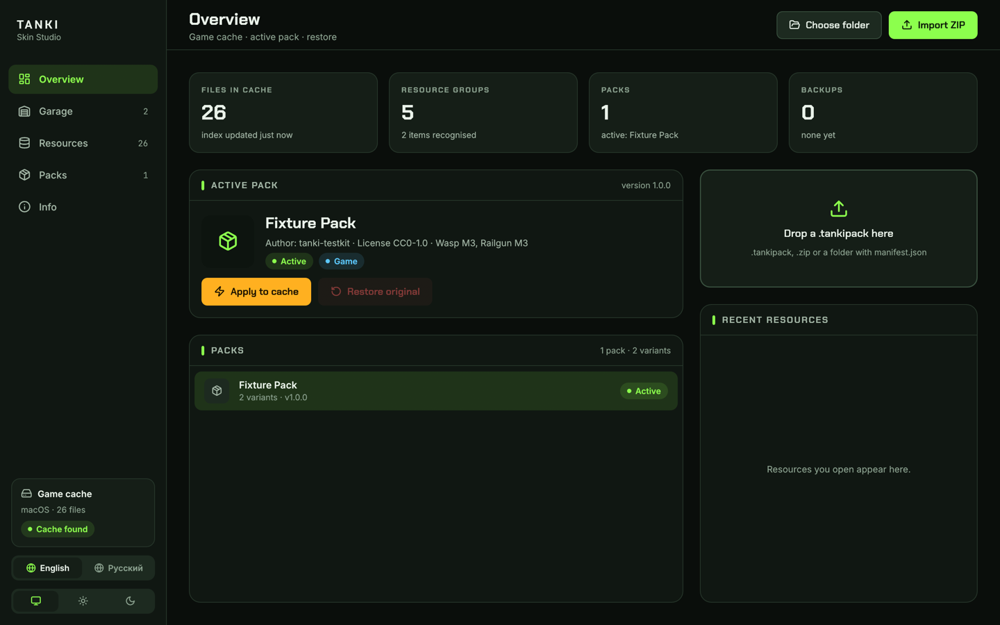
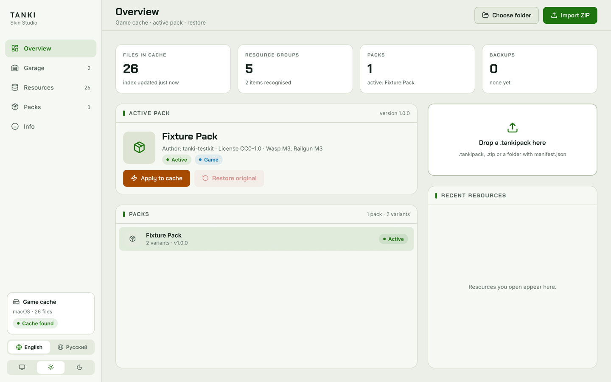

<h1 align="center">Tanki Skin Studio</h1>

<p align="center">
  <b>A safe, open-source skin manager for a local game cache, built in pure Rust.</b><br>
  Find your game cache, see what every file is, and swap hull and turret skins with one click and one-click undo.<br>
  macOS · Windows
</p>

<p align="center">
  
  
  
  
  
</p>

<p align="center">
  
  <br>
  <sub>The Garage. Every picture in this README is the app running on a <b>synthetic test cache</b>: the green squares are generated flat colours, not game art.</sub>
</p>

> [!IMPORTANT]
> **This repository contains no game files.** No textures, models, previews, sounds, cache dumps or
> skin packs, not one byte of game content. Tanki Skin Studio is a tool: it works on
> the cache already on *your* computer, with packs *you* choose to import. See
> [Clean by design](#clean-by-design).

<p align="center">
  <a href="#highlights">Highlights</a> ·
  <a href="#what-it-does">What it does</a> ·
  <a href="#clean-by-design">Clean by design</a> ·
  <a href="#how-it-works">How it works</a> ·
  <a href="#how-its-built">How it's built</a> ·
  <a href="#get-started">Get started</a> ·
  <a href="#command-line">Command line</a> ·
  <a href="#where-things-live">Where things live</a> ·
  <a href="#status">Status</a> ·
  <a href="#contributing">Contributing</a> ·
  <a href="#license-and-trademarks">License</a>
</p>

---

## Highlights

<table>
<tr>
<td width="33%" valign="top">

### Automatic
The cache is found on its own, and every hull, turret and modification is recognised by its
content: model geometry, texture look, preview picture. You pick a tank, not a base64 file name.

</td>
<td width="33%" valign="top">

### Undoable
Every replacement is one transaction. The original files are backed up and verified first, a
failure rolls everything back, and **Restore** puts the cache back byte for byte.

</td>
<td width="33%" valign="top">

### Clean
No game assets in the source, no network code, no account, no telemetry. The app touches only the
cache folder you point it at, and only after you confirm.

</td>
</tr>
</table>

---

## What it does

### Finds your cache and knows what is in it

- **Finds the game cache** on macOS and Windows on its own, or uses any folder you choose. It looks
  in the standard Adobe AIR application storage (`<application id>/Local Store/cache`) and keeps
  only folders whose files are cache entries, so no client is named in the code.
- **Indexes every file** in it, including images, models, archives, sounds and unknown formats, and
  decodes the client's base64 URL file names.
- **Recognises items by what they are, not by where they sit.** A hull or turret is matched by:
  - the SHA-256 of its files;
  - a fingerprint of its 3DS model's geometry;
  - a 16 × 16 "look" of its textures;
  - its Garage preview picture;
  - the order of its modification blocks, anchored by items already known.
- **Never guesses.** When two candidates are too close, the match is dropped, not picked. You can
  label any item by hand, and the label covers all of its modifications.

### Imports packs of any shape

- **`.tankipack` packs.** A ZIP or a folder with a [`manifest.json`](docs/pack-format.md). Every
  file's SHA-256 is checked, and paths, sizes and duplicate entries are validated. A broken or
  hostile archive is refused with the full list of its problems.
- **Plain folders of skins** made by other people, with no manifest. They become a pack
  automatically:
  - any nesting depth;
  - with or without `Old` / `New` folders;
  - typos in folder names (Damerau–Levenshtein distance via `strsim`);
  - XT, Prime and ALT editions;
  - files told apart by their content (3DS signature, preview size) when their names are unclear.
- **An import report** says what could not be used, so a differently laid-out archive never
  quietly imports less: unused files, formats the client cannot read, unrecognised folders, guesses
  to check.

### Applies only what will work

- **Any modification's skin fits the modification you selected.** An M0 skin can go on your M3 tank,
  as long as it is the same item.
- **An incomplete skin cannot be applied.** If a pack is missing any file the item needs (model,
  details, alpha, lightmap; only the preview is optional), the skin is marked **Incomplete**, Apply
  is disabled, and the missing file is named. Nothing is half-written.

<p align="center">
  
  <br>
  <sub>A skin missing its model: marked Incomplete, Apply disabled, the reason in plain words.</sub>
</p>

- **The confirmation lists exactly which cache files will change** before anything is written.
- **Waits while the game is running.** The client keeps its files open, so you are asked to close it
  first. The client is recognised on your machine, never by a name in the code: the cache's folder
  names its AIR application id, and a running program whose Adobe AIR descriptor
  (`META-INF/AIR/application.xml`) declares that id is the client.
- **PNG details are converted** to the client's JPEG colour and alpha files on the way in.

### Feels like a native app

- **Five pages:** Overview, Garage, Resources, Packs and Info.
- **A command palette** (<kbd>⌘K</kbd> / <kbd>Ctrl K</kbd>) and shortcuts: <kbd>⌘I</kbd> import,
  <kbd>⌘Z</kbd> restore, <kbd>⌘+</kbd> / <kbd>⌘−</kbd> / <kbd>⌘0</kbd> interface size.
- **English and Russian, dark and light themes.** Your language, theme, page, window place and
  selection are remembered between runs.
- **Adapts to the window size:** a narrow window turns the sidebar into an icon rail and stacks the
  columns.
- **One window per data folder.** A second launch is refused, so two windows never write the same
  cache at once.

<table>
<tr>
<td width="50%"></td>
<td width="50%"></td>
</tr>
<tr>
<td align="center"><sub>Overview, dark theme</sub></td>
<td align="center"><sub>The same page, light theme</sub></td>
</tr>
</table>

---

## Clean by design

Tanki Skin Studio is built so that the project itself never carries, ships or fetches anyone
else's game content.

### What is in this repository

| Kind | What it is | Where |
|---|---|---|
| Source code | Rust, GPL-3.0-or-later | `apps/`, `crates/`, `xtask/` |
| Fonts | Chakra Petch, Inter and JetBrains Mono (SIL Open Font License); Lucide icons (ISC). Each ships with its licence text | `crates/tanki-ui/assets/` |
| Licences | The text of every licence used, and the licence and copyright of every file ([REUSE](https://reuse.software) compliant) | `LICENSES/`, `REUSE.toml`, SPDX headers |
| App icon | Drawn by code at start-up; there is no image file | `apps/tanki-studio/src/icon.rs` |
| Interface design | The project's own design file | `design.pen` |
| Translations | English keys, Russian catalogue | `crates/tanki-i18n/src/ru.tsv` |
| Screenshots | The app running on the synthetic test cache | `docs/images/` |

### What is not in this repository

- **No textures, models, previews, maps or sounds** from the game.
- **No copies or dumps** of a game cache.
- **No skin packs**, and no links to download them.
- **No game executables**, launchers or patched clients.

### How that stays true

- **Tests never need game files.** `crates/tanki-testkit` builds a fake cache and fake packs at run
  time, from flat-colour images and placeholder bytes. The whole test suite, including the
  end-to-end runs in a real window, works on a machine that never had the game installed.
- **Tests against a real cache are opt-in.** They need three environment variables pointing at your
  own folders, and every one of them ends by proving the cache is byte-for-byte what it was.
- **Developer tools write outside the repository.** `cargo xtask sheet` and `cargo xtask previews`
  compare your local cache with your local archive; their pictures go to `/tmp/sheets` or the
  folder you name, never into the source tree.
- **`.gitignore`** keeps build output and packaged apps (`*.app`, `*.dmg`) out of version control.

### What the app does and does not do

- It **reads and writes only the cache folder you select**, plus its own data folder.
- It **has no network code.** Nothing is downloaded or uploaded, there is no account, and no usage
  data is collected.
- It **changes cosmetic files only**: models, textures and previews in the local cache. It does not
  touch the game's executable or memory, and it does not talk to any game server. A skin is visible
  only on your own screen.
- **Every change can be undone** from the app or the command line.

> [!NOTE]
> You are responsible for the packs you import: use skins you have the right to use, and check the
> rules of the server you play on.

---

## How it works

```text
 cache folder ──scan──▶ index of every file ──recognise──▶ hull / turret / modification
                                                                  │
 pack (.tankipack, zip, folder) ──validate──▶ skin variants ──────┤
                                                                  ▼
                              complete? ──no──▶ Incomplete, Apply disabled, reason shown
                                  │yes
                                  ▼
                 confirm the file list ─▶ game closed? ─▶ back up ─▶ write ─▶ verify
                                                                        │ failure
                                                                        ▼
                                                          roll back to the backup
```

A transaction records the SHA-256 of every file before and after it changes. **Restore** puts the
backups back, and a backup that was tampered with is refused rather than written into your cache.

---

## How it's built

A Cargo workspace of focused crates, layered so the core never depends on the interface. The
pattern follows [PdfCraft](https://github.com/storytold/pdfcraft). `cargo xtask layers` enforces the
layering on every CI run, and [docs/architecture.md](docs/architecture.md) has the details.

| Layer | Crate | What it does |
|---|---|---|
| 0 | `tanki-ui` | The interface kit drawn to `design.pen`: dark and light tokens, bundled fonts and icons, widgets, layout, interface zoom |
| 0 | `tanki-i18n` | Localisation: English keys in code, the Russian catalogue, plural rules, digit grouping |
| 1 | `tanki-cache` | Finding and scanning a cache; the item table and consecutive modification ids |
| 1 | `tanki-pack` | The `.tankipack` format, safe import from ZIP or folder, and building packs from plain folders |
| 2 | `tanki-apply` | Recognition by content, transactional apply with backup, verification and rollback, restore, game-running check |
| 2 | `tanki-state` | SQLite state (packs, active pack, recents, hand labels, preferences, session) and the data folder |
| 3 | `tanki-core` | The façade every front end uses, and the end-to-end tests that cross all layers |
| — | `tanki-studio` | The desktop app (egui / eframe, wgpu) |
| — | `tanki-cli` | The command-line tool |
| — | `tanki-testkit` | The synthetic cache and packs used by tests (a dev-dependency only) |
| — | `xtask` | Project automation: CI gate, layering, translations, screenshots, UI end-to-end runs |

**Quality gates.** `cargo xtask ci` runs on macOS and Windows for every change:

- a provenance check (`cargo xtask assets`) that refuses game file types and names, binaries
  outside their folders and dump-sized files in anything git would commit;
- `rustfmt`, and Clippy with warnings as errors;
- a check that every interface string has a Russian translation and no translation is stale;
- the crate layering rules;
- 125+ unit, integration and UI tests, with good and bad paths, hostile archives and tampered
  backups.

Beside it, CI checks that every file states its licence (REUSE), checks the dependencies with
`cargo-deny` (RustSec advisories, licences, sources),
builds with the minimum Rust version, and runs every workflow step with pinned actions and a
read-only token.

Two further layers of testing go beyond the gate:

- **The app in-process.** `egui_kittest` drives the interface without a window: it finds widgets by
  their accessible labels, clicks them and checks the files on disk. This includes seeded **monkey**
  and **chaos** runs that click, type, resize and press shortcuts at random, and then prove every
  change undoes cleanly.
- **The real window.** `cargo xtask e2e-ui` launches the real app on the synthetic cache. It checks
  every screen by its pixels and runs journeys (apply, restore, running game, refused pack,
  language after restart, random use), then verifies the disk afterwards.

The case-by-case map of behaviours and the tests that hold them is in
[docs/test-checklist.md](docs/test-checklist.md).

---

## Get started

**Download:** each release on the [Releases page](https://github.com/YuraZakaryan/tanki-skin-studio/releases)
has a universal `.dmg` for macOS 11 or later and, for Windows x64 and ARM, an `.msi` installer
(for your account, no administrator rights) and a portable `.zip`, with checksums and a
build-provenance attestation. Until the downloads are signed and notarized, macOS asks to allow the
app once in **System Settings → Privacy & Security → Open Anyway**, and on Windows SmartScreen asks
once (**More info → Run anyway**).

**Build from source** instead with **Rust 1.95 or later**:

- **macOS:** the Xcode Command Line Tools.
- **Windows:** the MSVC toolchain (Visual Studio Build Tools).

```sh
git clone https://github.com/YuraZakaryan/tanki-skin-studio.git
cd tanki-skin-studio
cargo run --release -p tanki-studio
```

1. **Find the cache.** Open the app: the cache is found automatically. If it is not, click
   **Choose folder**.
2. **Import a pack.** Drop a `.tankipack`, a ZIP or a skins folder on the window, or press <kbd>⌘I</kbd>.
3. **Apply a skin.** Close the game, open **Garage**, pick a tank and a modification, choose a skin
   and press the yellow **Apply** button.
4. **See it in the game.** Start the game again. To undo, use **Restore**.

**Your own packages:** `packaging/macos/package.sh` builds the `.dmg` and
`packaging/windows/package.ps1` the Windows `.msi` and `.zip`, into `dist/release/`. How releases are cut and
verified is in [docs/releasing.md](docs/releasing.md).

---

## Command line

`tanki-cli` does the same work without a window:

```sh
cargo run -p tanki-cli -- scan [cache-folder]                 # index the cache
cargo run -p tanki-cli -- recognise [cache-folder]            # items found by content (read only)
cargo run -p tanki-cli -- archive-pack <skins-folder> <pack>  # build a pack from a plain folder, with its import report
cargo run -p tanki-cli -- pack-validate <pack>                # check a pack without importing it
cargo run -p tanki-cli -- import <pack>                       # import a .tankipack, ZIP or folder
cargo run -p tanki-cli -- packs                               # list imported packs
cargo run -p tanki-cli -- apply <pack-id> <variant-id> [cache-folder]
cargo run -p tanki-cli -- restore                             # undo the latest apply
```

---

## Where things live

| What | macOS | Windows |
|---|---|---|
| Game cache (found automatically) | `~/Library/Application Support/<application id>/Local Store/cache` | `%APPDATA%\<application id>\Local Store\cache` |
| App data: state, imported packs, backups, logs | `~/Library/Application Support/TankiSkinStudio` | `%APPDATA%\TankiSkinStudio` |

Inside the data folder:

- `state.sqlite` holds packs, preferences and hand labels.
- `packs/` holds the imported packs.
- `backups/` holds one folder per transaction.
- `logs/tanki-studio.log` is the current log. The two previous runs are kept as `.1.log` and
  `.2.log`, and each file is capped at 16 MiB. It is the file to attach to a bug report.

**Environment variables:**

- `TANKI_DATA_DIR` uses another data folder.
- `TANKI_CACHE_DIR` uses another cache folder.
- `RUST_LOG` changes how much is logged, for example `RUST_LOG=debug`.

The test hooks (`TANKI_VIEW`, `TANKI_SHOT`, `TANKI_ACTIONS` and others) are documented in
`apps/tanki-studio/src/dev.rs`.

---

## Status

**Where it stands (October 2026), honestly:** early, but complete for its main job.

- **Works today on macOS:** finding the game cache, recognising hulls and turrets, importing
  packs and plain skin folders, applying and restoring, the full interface in English and Russian.
- **Windows:** the app builds and the full test suite passes on Windows in CI. It has not yet had
  the same hands-on use as on macOS.
- **Not yet:**
  - signed downloads (a notarized macOS app, signed Windows executables);
  - a Linux build;
  - parsing `.tara` archives;
  - a pack authoring and export flow.

[docs/roadmap.md](docs/roadmap.md) lists the next milestones, and [docs/pack-format.md](docs/pack-format.md)
describes the pack format for authors.

---

## Contributing

Issues and pull requests are welcome: start with **[CONTRIBUTING.md](CONTRIBUTING.md)**. The rules
for people and AI agents alike are in **[AGENTS.md](AGENTS.md)**, every pull request fills in
[the template](.github/pull_request_template.md), and everyone follows the
[Code of Conduct](CODE_OF_CONDUCT.md). Security problems go privately through
[SECURITY.md](SECURITY.md). Changes are recorded in [CHANGELOG.md](CHANGELOG.md). In short:

1. **Run the gate:** `cargo xtask ci`, and `cargo xtask e2e-ui` for interface changes (it needs a
   desktop session).
2. **Never commit game files**: no textures, models, previews, cache folders or packs, not even in
   a test. Add what a test needs to `tanki-testkit`, generated at run time. `cargo xtask assets`
   refuses them.
3. **Keep the layering:** a crate may depend only on lower layers (`cargo xtask layers`).
4. **Translate new interface text:** every new string needs a row in `ru.tsv`.
   `cargo xtask i18n --template` prints the missing rows.
5. **Branch and merge:** `<type>/<slug>` branches (`feat/`, `fix/`, `docs/`…), squash-merged into
   `main` once CI is green.

Dependabot opens one grouped update a week for Rust crates and one for GitHub Actions.

---

## License and trademarks

Copyright (C) 2026 Tanki Skin Studio contributors.

Tanki Skin Studio is free software: you can redistribute it and/or modify it under the terms of the
GNU General Public License as published by the Free Software Foundation, either version 3 of the
License, or (at your option) any later version. It is distributed in the hope that it will be
useful, but WITHOUT ANY WARRANTY; without even the implied warranty of MERCHANTABILITY or FITNESS
FOR A PARTICULAR PURPOSE. See the [GNU General Public License](LICENSE) for more details.

In short: you may use, study, change and share it, also commercially, but a version you distribute
must stay open under the same licence, with its source. The bundled fonts and icons keep their own
licences, which sit next to them in `crates/tanki-ui/assets/`. Commits published before the switch
to GPL-3.0 on 2026-10-29 were released under the MIT License.

Tanki Skin Studio is an independent fan project. It is **not affiliated with, endorsed by or
connected to** any game, game client or their developers, and it names none of them. The names of
in-game items are property of their respective owners and are used here only to describe
compatibility. All game content belongs to its owners and is not part of this project.
